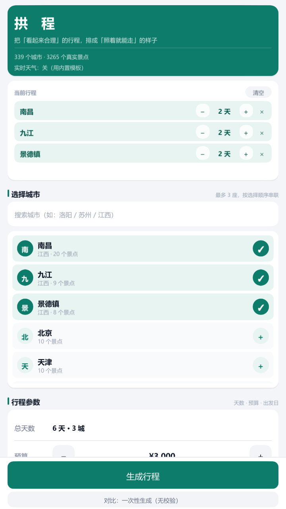
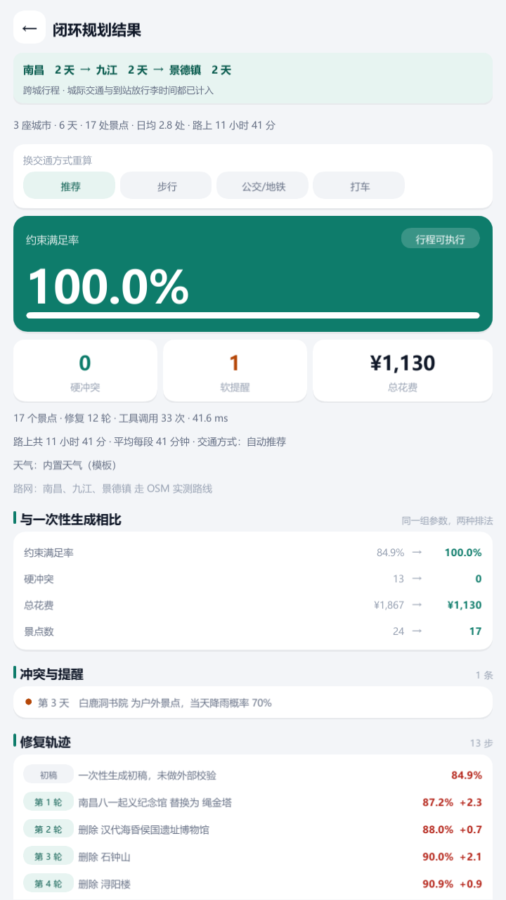
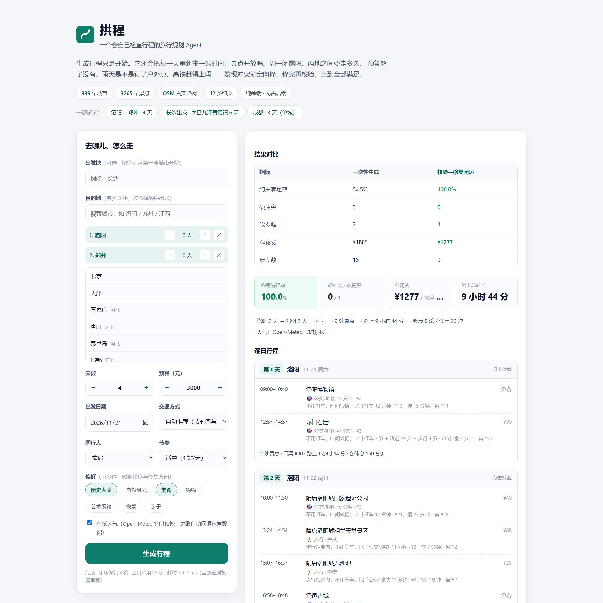
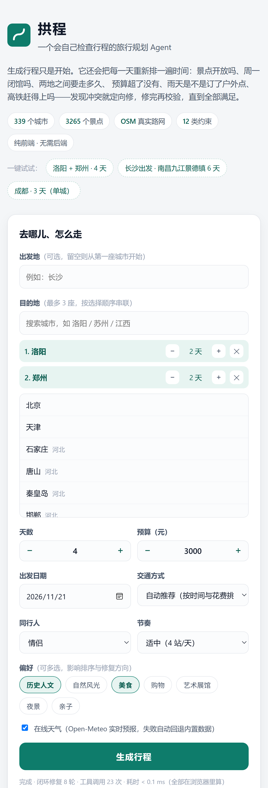
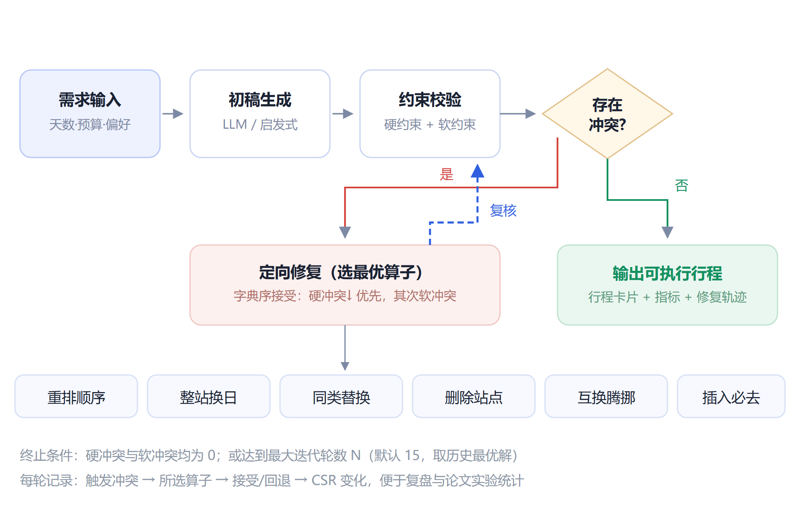
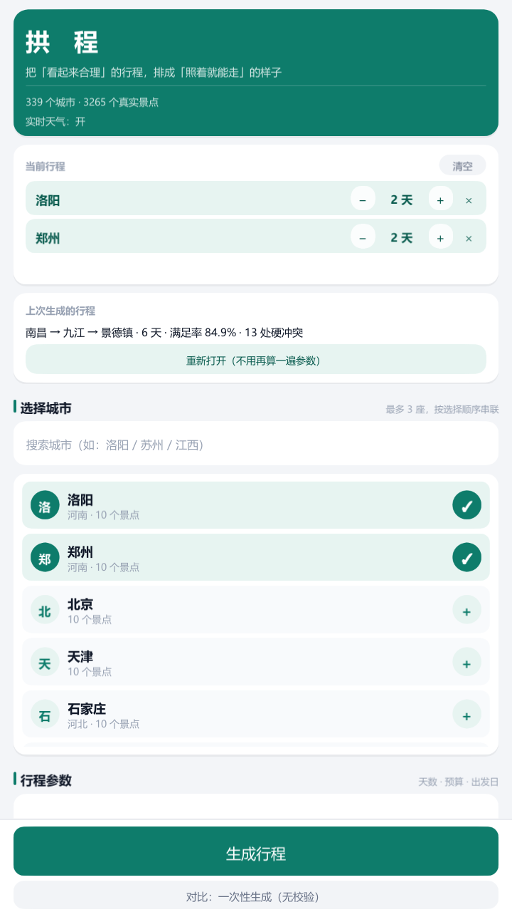
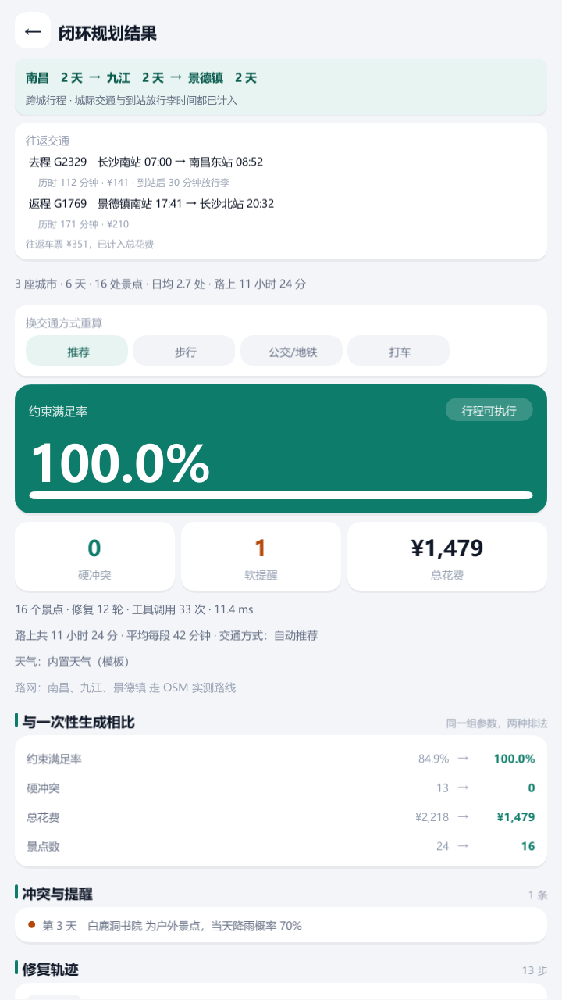
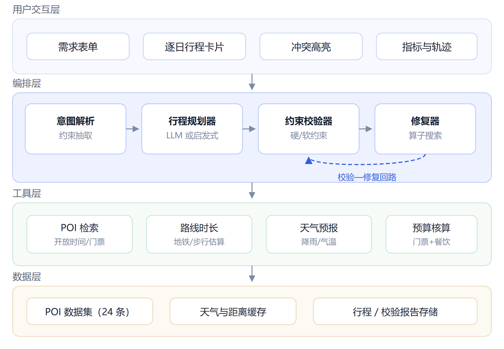

# 拱程 · 多约束行程规划智能体

> 把"看起来合理"的行程，变成"照着就能走"的行程。

一个把**生成**与**验证**解耦的行程规划 Agent：规划器只负责给出候选，校验器用 12 类硬/软约束把它拆成可定位的冲突码，修复器按冲突码定向修改，直到收敛。同一套算法有 **Python / 纯 C# / 浏览器 JS** 三份实现，用 golden snapshot 逐字段回归锁定语义（25 组档案 × 2 模式，容差 1e-6）。

`Python 3.12（零三方依赖）` · `C# / .NET 8` · `Unity 2022.3 + IL2CPP` · `浏览器 JS（零依赖）` · `339 城` · `3265 个景点` · `25 组档案 × 2 模式回归`

| 首页 | 结果页 |
| --- | --- |
|  |  |

### 👉 在线试用（无需安装任何东西）

**https://wyf1433223.github.io/gongcheng-trip-agent/**

纯静态页：整套规划—校验—修复引擎已经移植成浏览器里的 JavaScript，打开就能排行程，没有任何后端或 API。首页有三个一键示例，也可以自己选城市、填出发地、改交通方式。

| 网页版 · 桌面 | 网页版 · 手机宽度（单列） |
| --- | --- |
|  |  |

---

## 1. 要解决的问题

让模型"生成一份行程"从来不难，难的是这份行程**能不能照着走**。一次性生成的结果在真实约束下几乎必然翻车：

- 把周一闭馆的博物馆排在周一；
- 把两个隔了 40 公里的景点塞进同一个下午；
- 走到景点门口才发现已经过了停止入场时间；
- 预算 2000，排出来的门票加交通要 2600；
- 用户点名要去的景点，被排到了根本去不了的那一天。

项目的核心主张是：**不要把正确性交给生成器自证**。把"合理"翻译成可枚举、可计算的约束，让每一条冲突都有名字、有位置、有修法。

## 2. 三段闭环



```
需求(天数/预算/偏好/同行人/交通方式/出发地)
        │
        ▼
   规划器 Planner ──► 候选行程
        │                 │
        │                 ▼
        │          校验器 Verifier ──► 冲突码 + CSR
        │            (12 类约束)         │
        │                 │ 有冲突         │ 无冲突
        │                 ▼              ▼
        └──────── 修复器 Repair ◄──   输出行程
                 (6 类定向算子)
```

- **校验器**把行程推演成时间轴（到站、等待、游玩、城际、午餐、返程），逐条判定并产出 `{code, severity, day, poi_id, message, fix}`。硬约束 8 类（开放时间、闭馆日、日超时、预算、必去点、空日、重复、节奏超标），软约束 4 类（雨天户外、等待过长、缺餐饮、偏好不足）。
- **修复器**不重跑生成，只按冲突码挑算子：`换日 / 替换 / 删除 / 插入 / 交换 / 跨天对调`，候选先过"城市合法性"再构造校验，首改进即接受，并用签名去重避免原地打转。
- **可解释**：每一步修复都留下可读轨迹（第几轮、动了哪天、CSR 怎么变），前端可以整段展示。

## 3. 效果

20 组固定档案（成都数据，真实 OSM 路网耗时），指标定义见 [results/summary.md](results/summary.md)：

| 指标 | 一次性生成 | 闭环修复 |
| --- | --- | --- |
| 约束满足率 CSR | **89.83%** | **100.00%** |
| 可执行率 ER（零硬冲突） | **5.00%** | **100.00%** |
| 偏好匹配率 PREF | 67.83% | 63.78% |
| 平均工具调用 | 5.45 | 18.95（无缓存 98.70） |
| 平均修复轮次 | 0 | 6.25 |
| 平均单次耗时 | 0.14 ms | 1.56 ms |

一次性生成里 19/20 组都带硬冲突；闭环修复后 20/20 组清零。

**如实报告的负面结果**：访问去重对收敛没有影响（6.25 轮 vs 6.25 轮）；最优改进把耗时抬到 6.57 ms 却只换来 2 pp 偏好；修硬约束会牺牲偏好（-4.05 pp）——这些都是设计取舍，不是调参失败。

## 4. 功能

- **339 个地级市可选**，按省份/关键字搜索，可勾选最多 3 座城市并逐城分配天数，生成跨市行程。
- **出发地**：填写自己所在城市，去程与返程高铁自动接入，行程首尾两端都排得出来。
- **每段推荐出行方式**：步行 / 公交地铁 / 打车 /「打车接轨道」组合，按 `时间 + 成本×时间价值` 取最优，并说明为什么选它（比另一种快几分钟、省几块钱）。
- **城际用真实车次形态**：按城际距离推算高铁班次（车次号、出发/到达站、时刻、历时、票价），跨城当天从到站时刻开始重排。
- **实时天气**：Open-Meteo 预报驱动，下雨自动把户外点换成室内点；超出预报范围回退内置天气，并明确标注。
- **两种模式对照**：结果页直接给出"如果跑一遍闭环 / 如果只生成一次"的对比卡。
- **分享**：系统分享面板（微信/QQ）、保存行程图到相册、复制行程文本。

| 城市选择 | 往返高铁 | 逐日展开 |
| --- | --- | --- |
|  |  |  |

## 5. 架构



```
Web / Android(Unity)    ── 用户交互层
        │
编排层  engine.run(profile, mode)  ── 规划 → 校验 → 修复 → 再校验
        │
工具层  weather(Open-Meteo) · rail(班次) · multimodal(换乘) · routes(路网) · cache(TTL)
        │
数据层  339 城 POI 快照 · 省—市目录 · OSM 路网矩阵
```

## 6. 快速开始

### 6.1 后端 + 网页演示（Python，零依赖）

```bash
cd travel-agent-thesis
python -m agent.engine            # 命令行跑一次对比
python -m agent.server            # 打开 http://127.0.0.1:8823
python experiments.py             # 重跑 E1~E5，产物写入 results/
```

### 6.2 双实现一致性回归（C#）

```bash
dotnet run --project unity/harness/Harness.csproj -- \
    unity/golden.json agent/cities unity/out_csharp.json
python unity/diff_golden.py       # 期望输出：一致：25 组档案 × 2 模式，全部字段相同。
```

`unity/golden.json` 是由 Python 侧 `unity/gen_golden.py` 导出的快照（CSR、冲突码、每站到离时刻、城际车次与票价、往返车票），C# 侧跑同样的档案后逐字段比对，容差 `1e-6`。

### 6.3 手机 App（Unity）

```bash
# 用 Unity 2022.3 打开 unity/AndroidApp，或直接命令行出包：
Unity.exe -batchmode -quit -projectPath unity/AndroidApp -executeMethod BuildApk.Build
```

产物 `TravelAgent.apk`。核心算法在 `Assets/Scripts/Core/`，与 `unity/core/` 是同一份代码，不引用 `UnityEngine`，所以能脱离 Unity 跑测试。

### 6.4 纯静态网页（浏览器端引擎，即在线演示）

`web/engine/*.js` 是同一套算法的第三份实现（JS ESM，零依赖），浏览器里直接跑，因此在线演示不需要任何后端：

```bash
python -m http.server 8899 --directory .    # 然后打开 http://127.0.0.1:8899
node web/engine/test_golden.mjs . unity/golden.json
# 期望：一致：25 组档案 × 2 模式，全部字段相同。
```

数据用 `fetch` 按需加载（`agent/directory.json` + 选中的 `agent/cities|routes/<key>.json`），所以首页很轻。

## 7. 目录

```
index.html        在线演示入口（纯静态，GitHub Pages 直接托管）
web/              浏览器端：app.js 界面 + engine/*.js 引擎（JS 第三实现）
agent/             Python 引擎：data / model / verifier / repair / planner / engine
  cities/          339 城 POI 快照（JSON）
  routes/          339 城景点两两耗时矩阵（OSM）
  directory.json   省—市目录（339 城，含坐标）
experiments.py     E1~E5 实验脚本
results/           实验产物（表格 + 图）
unity/core/        纯 C# 核心（与 Python 逐行对齐）
unity/harness/     C# 验收脚手架
unity/golden.json  Python 导出的期望快照
unity/diff_golden.py 逐字段比对
unity/AndroidApp/  Unity 工程（只含源码与配置）
docs/              架构图、闭环图、界面截图
```

## 8. 数据来源与边界

- **景点数据**：以公开景点页面的内嵌信息为初始来源，做过同一城市同名消歧、坐标/票价/开放时段的规则化推断，是**某一时点的快照**，不保证实时准确。行程里的开放时间、票价请以现场为准。
- **路网耗时**：步行/驾车基于 OSM 路网矩阵；公交地铁按市区均速加候车换乘时间估算；**高铁班次是按里程推算的形态（车次号、时刻非实时），不是 12306 真实余票**。
- **天气**：实时预报来自 Open-Meteo（免费、无需 Key）；预报覆盖约 16 天，超出范围回退内置模板并标注来源。
- **修复能力边界**：启发式算子不保证全局最优，个别档案（如机场往返、必去点与闭馆日撞车）会停在 1 条硬冲突；跨城当天若长途占满全天，会被判"空日"——转场日建模列为后续工作。

## 9. 后续

1. 把规则规划器换成 LLM（接口已预留），并把校验器冲突码当作**过程奖励**用于偏好优化——即"可验证的 Agent 轨迹挖掘"。
2. 转场日建模：让长途交通日只承担移动与轻量游玩，而不是被判定为空日。
3. 接入真实车次与余票、真实景点营业数据，替换当前快照。
4. 把离线快照升级为可增量更新的数据管线。

## 10. 说明

本仓库只包含可运行的工程与数据，不含个人材料。景点、门票与车次信息均为公开信息快照，仅用于演示，请以现场与官方渠道为准。

## License

MIT，见 [LICENSE](LICENSE)。数据与酒店/车次信息仅用于教学演示。